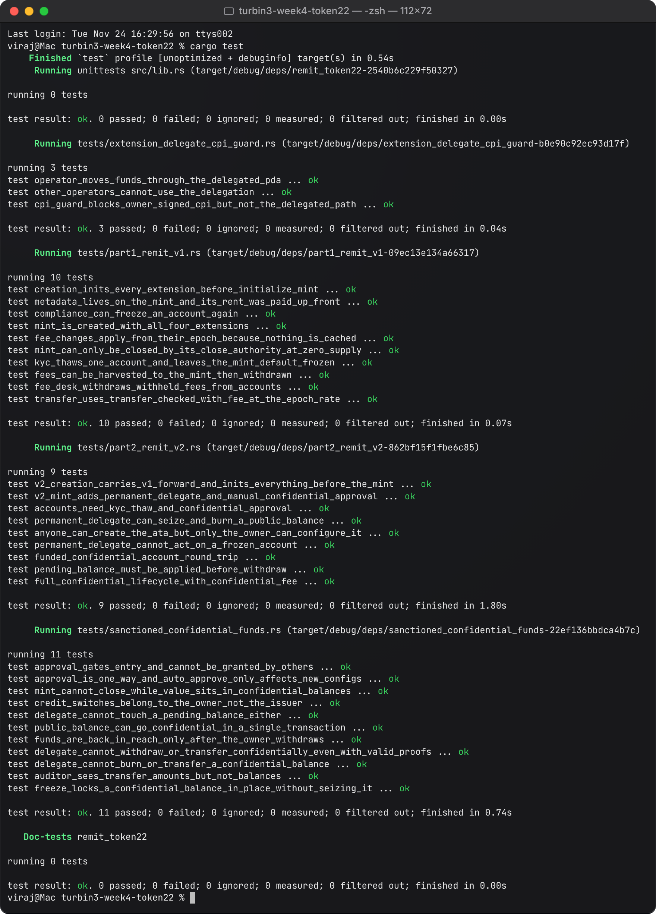

# turbin3-week4-token22

A remittance stablecoin built on Token-2022, for Week 4 of the Turbin3 Builders Cohort.

The token is **Remit Dollar (RMTD)**, 6 decimals, pegged to USD. It comes in two versions:

- **v1, public:** transfer fee, metadata pointer with the metadata stored on the mint, accounts frozen by default until KYC, and a mint close authority.
- **v2, confidential:** everything in v1, plus a permanent delegate and confidential transfers (manual approval), including confidential transfer fees.

The mint itself is built only from Token-2022 extensions. The tests drive the real Token-2022 SBF program inside `solana-program-test`, including the on-chain verification of every zero-knowledge proof. For the extension challenge there is one small on-chain program, `programs/remit-agent`, that moves tokens as an approved delegate through a CPI into Token-2022.

Everything is in Rust because confidential transfers need ZK proofs generated on the client (`solana-zk-sdk` and `spl-token-confidential-transfer-proof-generation`), and the TypeScript `@solana/spl-token` package only builds instructions. It has no proof generation for these flows.

## Requirement checklist

Each assignment requirement, where it is implemented and the test that checks it.

| # | Requirement | Implementation | Test(s) |
|---|---|---|---|
| 1a | Mint stacks `TransferFeeConfig`, `MetadataPointer` (pointing at the mint), `DefaultAccountState` (frozen), `MintCloseAuthority` | `src/remit.rs`: `V1_EXTENSIONS`, `plan_mint` | `part1_remit_v1::mint_is_created_with_all_four_extensions`, `metadata_lives_on_the_mint_and_its_rent_was_paid_up_front` |
| 1b | Space from `ExtensionType::try_calculate_account_len` | `plan_mint`: `space = ExtensionType::try_calculate_account_len::<Mint>(extensions)` | `creation_inits_every_extension_before_initialize_mint` asserts `plan.space` equals it |
| 1c | Every extension init comes before `InitializeMint` | `plan_mint` builds the instruction list in order; `create_mint` sends exactly that list | `creation_inits_every_extension_before_initialize_mint` (v1) and `part2_remit_v2::v2_creation_carries_v1_forward_and_inits_everything_before_the_mint` (v2) decode the actual instructions with `TokenInstruction::unpack` and assert the order |
| 1d | Metadata after the mint, rent for variable-length `TokenMetadata` accounted for | `plan_mint` + `metadata_entry_len`: `CreateAccount` allocates only the fixed size but is funded with `rent.minimum_balance(space + metadata_entry_len)`; see [Mint creation](#mint-creation) | `metadata_lives_on_the_mint_and_its_rent_was_paid_up_front` asserts final length = fixed + entry length and lamports = exact rent-exempt minimum for that length (v2 checks the same) |
| 2a | Transfers use `transfer_checked_with_fee` | `src/remit.rs`: `transfer` → `transfer_with_fee_unchecked` → `transfer_fee::instruction::transfer_checked_with_fee`. No other public transfer path in `src/` or `tests/` | `transfer_uses_transfer_checked_with_fee_at_the_epoch_rate` (incl. `FeeMismatch` for a wrong fee) |
| 2b | Fee from `calculate_epoch_fee(current_epoch, amount)`, epoch from the Clock sysvar, no cached rate | `src/remit.rs`: `current_fee` reads `Clock` (`Env::clock` → `get_sysvar::<Clock>`) and the mint's `TransferFeeConfig` on every call | `fee_changes_apply_from_their_epoch_because_nothing_is_cached`: raises the fee to 1%, same epoch still charges 0.5%, after warping 2 epochs the same call charges 1% |
| 3 | State read through `StateWithExtensions`, never raw `Pack::unpack` | `src/state.rs`: `RawAccount::mint` / `token_account` (`StateWithExtensions::<Mint/Account>::unpack`); every read in `src/` and `tests/` goes through it | All tests. `rg "Pack::unpack\|unpack_from_slice\|get_account_info\|get_mint_info" src tests` finds only the doc comment in `state.rs` |
| 4 | Freeze authority thaws one account after KYC; mint default state unchanged | `RemitV1::kyc_approve` / `RemitV2::kyc_approve` (`ThawAccount` by `freeze_authority`) | `kyc_thaws_one_account_and_leaves_the_mint_default_frozen`: thaw works, `DefaultAccountState` on the mint is still `Frozen`, the next new account is still frozen |
| 5 | Re-issue with the same extensions + `PermanentDelegate` + confidential transfers, approve policy manual | `V2_EXTENSIONS`, `RemitV2::create` (`auto_approve_new_accounts = false`) | `v2_creation_carries_v1_forward_and_inits_everything_before_the_mint`, `v2_mint_adds_permanent_delegate_and_manual_confidential_approval`, `accounts_need_kyc_thaw_and_confidential_approval` |
| 6a | `ConfigureAccount` is owner-only, distinct from ATA creation | `src/confidential.rs`: `configure` (owner reallocates + `ConfigureAccount`) | `anyone_can_create_the_ata_but_only_the_owner_can_configure_it`: a third party funds and creates the owner's ATA, then its `Reallocate` and `ConfigureAccount` both fail with `OwnerMismatch`; the owner's succeed |
| 6b | Deposit → apply pending → confidential transfer → withdraw | `confidential::{deposit, apply_pending, transfer_with_fee, withdraw}` | `full_confidential_lifecycle_with_confidential_fee`, `funded_confidential_account_round_trip` |
| 6c | Pending balance applied before withdrawal | `confidential::withdraw` proves against the *available* balance | `pending_balance_must_be_applied_before_withdraw`: before apply, the client can't build a proof; proofs built against the pending ciphertext verify in the ZK program but Token-2022 rejects the withdraw with `ConfidentialTransferBalanceMismatch`; after apply the same withdraw succeeds |
| Ext | Program gets delegated authority via `Approve`, transfers by CPI; still works under CPI Guard; owner-signed CPI is blocked | `programs/remit-agent` (on chain), `src/agent.rs` (client) | `extension_delegate_cpi_guard::operator_moves_funds_through_the_delegated_pda`, `other_operators_cannot_use_the_delegation`, `cpi_guard_blocks_owner_signed_cpi_but_not_the_delegated_path` |

## Layout

```
src/
  env.rs           local bank: program-test + Token-2022 + remit-agent from tests/fixtures,
                   Clock / Rent sysvars, epoch warp
  state.rs         every account read: StateWithExtensions::<Mint/Account>::unpack
  remit.rs         RemitV1 / RemitV2: roles, extension lists, mint plan (instruction order,
                   size, rent), epoch-based fee, transfer_checked_with_fee
  confidential.rs  key derivation, configure, deposit, apply, transfer with fee,
                   withdraw, confidential fee withdrawal (proofs via context accounts)
  agent.rs         instruction builders for the remit-agent program
programs/remit-agent/             on-chain program for the extension challenge
tests/
  part1_remit_v1.rs               Part 1
  part2_remit_v2.rs               Part 2
  sanctioned_confidential_funds.rs  what the issuer can / can't do with confidential funds
  extension_delegate_cpi_guard.rs   delegated CPI transfers under CPI Guard
  common/mod.rs                   error assertions, onboarding helpers, tx size
  fixtures/spl_token_2022.so      Token-2022 program, built from source
  fixtures/remit_agent.so         programs/remit-agent, built with cargo build-sbf
scripts/build-token-2022.sh       rebuilds the Token-2022 fixture
scripts/build-agent.sh            rebuilds the remit-agent fixture
TECHNICAL_NOTES.md                findings on sanctions vs. confidential balances
```

## Roles

Every privileged action uses its own key, so the tests can show exactly which key can do what.

| Role | Key | Can |
|---|---|---|
| Issuer | `mint_authority` | Mint against fiat received off chain |
| Compliance | `freeze_authority` | Thaw an account after KYC, freeze it on a sanctions hit |
| Fee config | `fee_config_authority` | Change the transfer fee |
| Fee desk | `withdraw_withheld_authority` | Collect withheld transfer fees |
| Metadata | `metadata_authority` | Update the metadata and the metadata pointer |
| Wind-down | `close_authority` | Close the mint once the supply is zero |
| Seizure (v2) | `permanent_delegate` | Transfer or burn from any account of the mint |
| Confidential gate (v2) | `confidential_authority` | Approve accounts for confidential transfers (auto-approve is off) |
| Auditor (v2) | `auditor` ElGamal key | Decrypt the amount of every confidential transfer |
| Fee desk (v2) | `withdraw_withheld_elgamal` | Decrypt and withdraw fees withheld on confidential transfers |

## Part 1: the public mint

| Extension | Setting | Shown in |
|---|---|---|
| `TransferFeeConfig` | 0.50% (50 bps), capped at 5 RMTD | `transfer_uses_transfer_checked_with_fee_at_the_epoch_rate`, `fee_changes_apply_from_their_epoch_because_nothing_is_cached`, `fee_desk_withdraws_withheld_fees_from_accounts`, `fees_can_be_harvested_to_the_mint_then_withdrawn` |
| `MetadataPointer` + `TokenMetadata` | The pointer is set to the mint itself. Name, symbol, URI and an extra `peg = USD` field | `metadata_lives_on_the_mint_and_its_rent_was_paid_up_front` |
| `DefaultAccountState` | `Frozen`: every new account is frozen until compliance thaws it | `kyc_thaws_one_account_and_leaves_the_mint_default_frozen`, `compliance_can_freeze_an_account_again` |
| `MintCloseAuthority` | Separate wind-down key | `mint_can_only_be_closed_by_its_close_authority_at_zero_supply` |

### Mint creation

`remit::plan_mint` builds the whole mint in one transaction, in this order (v2 additions in brackets):

1. `system::CreateAccount`: `space = ExtensionType::try_calculate_account_len::<Mint>(extensions)`, `lamports = rent.minimum_balance(space + metadata_entry_len)`
2. `InitializeTransferFeeConfig`
3. `MetadataPointer::Initialize` (metadata address = the mint)
4. `InitializeDefaultAccountState(Frozen)`
5. `InitializeMintCloseAuthority`
6. [`InitializePermanentDelegate`, `ConfidentialTransfer::InitializeMint`, `ConfidentialTransferFee::InitializeConfidentialTransferFeeConfig`]
7. `InitializeMint2`
8. `TokenMetadata::Initialize` (name, symbol, URI)
9. `TokenMetadata::UpdateField(peg = USD)`

Why metadata comes after the mint, and how its rent is covered:

- **Fixed extensions first.** `InitializeMint` requires the account length to equal exactly `try_calculate_account_len` of the extensions already initialised ([processor.rs L132-L137](https://github.com/solana-program/token-2022/blob/1d91cfca9395a24adcdc453b38cb776d9624ff8e/program/src/processor.rs#L132-L137)), so every fixed-size extension has to be initialised before it, and the account can't be allocated with extra room for the metadata.
- **Metadata after.** `TokenMetadata` is variable length and is written by the token-metadata instructions, which need an initialised mint and the mint authority's signature. Token-2022 grows the account itself when writing it ([`alloc_and_serialize_variable_len_extension`](https://github.com/solana-program/token-2022/blob/1d91cfca9395a24adcdc453b38cb776d9624ff8e/interface/src/extension/mod.rs#L1496)).
- **Rent paid up front.** The growth is not funded by Token-2022, so `CreateAccount` deposits the rent-exempt minimum for the *final* size. The final entry is a 2-byte type, a 2-byte length and the Borsh-packed metadata ([`add_type_and_length_to_len`](https://github.com/solana-program/token-2022/blob/1d91cfca9395a24adcdc453b38cb776d9624ff8e/interface/src/extension/mod.rs#L138)); `remit::metadata_entry_len` computes that. `TokenMetadata::tlv_size_of` is not used because it measures a generic TLV entry (8-byte discriminator + 4-byte length), 8 bytes more than Token-2022 writes.
- **Checked.** The tests decode the instruction list, assert the order and the `space`, check that the mint ends up with exactly `space + metadata_entry_len` bytes and exactly the rent-exempt lamports for that size, and that the creation transaction fits in a 1232-byte packet (v1 is 920 bytes).

### Fees

On every transfer, `fee = ceil(amount * 50 / 10_000)`, capped at 5 RMTD. The fee stays in the *receiver's* account as `withheld_amount`, so the receiver can't spend it. There are two ways to collect it:

- `withdraw_withheld_tokens_from_accounts`: the fee desk pulls the fees straight from the accounts that hold them.
- `harvest_withheld_tokens_to_mint`: anyone can move the withheld fees into the mint. The fee desk then calls `withdraw_withheld_tokens_from_mint`.

Fees are moved, not burned, so the supply doesn't change.

**Epoch-based fee.** `remit::transfer` is the only transfer path. It reads the current epoch from the Clock sysvar and the mint's `TransferFeeConfig`, computes `calculate_epoch_fee(epoch, amount)` and sends `TransferCheckedWithFee` with that fee. Token-2022 recomputes the fee the same way ([processor.rs L419](https://github.com/solana-program/token-2022/blob/1d91cfca9395a24adcdc453b38cb776d9624ff8e/program/src/processor.rs#L419)) and rejects a mismatch with `FeeMismatch`. A fee change made with `SetTransferFee` only takes effect two epochs later ([transfer_fee/processor.rs L106](https://github.com/solana-program/token-2022/blob/1d91cfca9395a24adcdc453b38cb776d9624ff8e/program/src/extension/transfer_fee/processor.rs#L106)), so a cached rate would be wrong in that window; the epoch test checks both sides of it.

**KYC flow.** The account is created as an ATA and starts frozen. Minting to it fails with `AccountFrozen`. The freeze authority then thaws that one account, and only the freeze authority can. The mint's `DefaultAccountState` stays `Frozen`, so every later account still starts frozen.

**Closing the mint.** Closing fails with `MintHasSupply` while any token exists, including fees still withheld. To wind down: collect the fees, burn everything, then the close authority closes the mint and gets the rent back.

## Part 2: permanent delegate + confidential transfers

v2 keeps all four v1 extensions with the same settings and adds `PermanentDelegate`, `ConfidentialTransferMint` (`auto_approve_new_accounts = false`, i.e. manual approval) and `ConfidentialTransferFeeConfig`. The fee config is required whenever a mint has both a transfer fee and confidential transfers ([`InvalidExtensionCombination` otherwise](https://github.com/solana-program/token-2022/blob/1d91cfca9395a24adcdc453b38cb776d9624ff8e/interface/src/extension/mod.rs#L1356-L1358)), because the fee on a confidential transfer is withheld encrypted.

### Onboarding

```
open ATA (frozen) -> compliance thaws -> owner reallocates + ConfigureAccount -> confidential authority approves
```

The owner's ElGamal and AES keys are derived from the owner's signature over a fixed message, the way wallets do it. `ConfigureAccount` carries a pubkey-validity proof.

Creating the ATA and configuring it are separate steps with separate signers. Anyone can create (and pay for) a user's ATA. `Reallocate` and `ConfigureAccount` both need the account owner's signature, so `anyone_can_create_the_ata_but_only_the_owner_can_configure_it` has a third party create the ATA and then fail both with `OwnerMismatch`.

### Lifecycle

```
            deposit              apply pending          confidential transfer (+ fee)
 public ───────────────▶ pending ─────────────▶ available ─────────────────────────▶ receiver pending
 amount                                            │                                     │ apply
   ▲                                               │ withdraw                            ▼
   └───────────────────────────────────────────────┘                              receiver available
```

| Step | Instruction | Proofs | Signer |
|---|---|---|---|
| Configure | `ConfigureAccount` | Pubkey validity | Owner |
| Deposit | `Deposit` (plaintext amount) | None | Owner |
| Apply pending | `ApplyPendingBalance` | None. The owner decrypts the pending balance and writes the new AES-encrypted available balance | Owner |
| Transfer | `TransferWithFee` | Ciphertext-commitment equality, amount ciphertext validity (3 handles, includes auditor), percentage-with-cap (fee), fee ciphertext validity, batched range proof | Owner |
| Withdraw | `Withdraw` (plaintext amount) | Ciphertext-commitment equality, range | Owner |
| Collect confidential fees | `WithdrawWithheldTokensFromAccounts` | Ciphertext-ciphertext equality | Withdraw-withheld authority |

The large proofs are first verified into **context state accounts** (one transaction each). The token instruction then references those accounts, and they are closed afterwards to get the rent back. This keeps every transaction under the 1232-byte limit, so the same flow works on a real cluster.

`full_confidential_lifecycle_with_confidential_fee` runs the whole lifecycle and checks the decrypted balances after every step:

1. **Setup:** three accounts are onboarded (sender, receiver, fee desk) and the sender is minted 1,000 RMTD in public.
2. **Deposit:** the sender deposits 400. Public is now 600 and pending is 400.
3. **Apply:** the sender applies the pending balance, so available is 400.
4. **Confidential transfer:** the sender sends 100 confidentially.
   - The sender's available balance drops to 300.
   - The receiver's pending balance is 99.5, and 0.5 is withheld as an encrypted fee.
   - The auditor decrypts the transfer amount (100) from the instruction's ciphertexts.
   - The receiver's public `amount` stays at 0.
5. **Apply and withdraw:** the receiver applies (available 99.5), then withdraws 50 to public.
6. **Fee collection:** the fee desk decrypts the withheld 0.5 and withdraws it into its own confidential balance.
7. **Supply check:** the supply stays at 1,000 the whole time.

`pending_balance_must_be_applied_before_withdraw` shows why the apply step matters. After a deposit, the funds are only in the pending balance and `Withdraw` works on the available balance:

- An honest client can't even build the withdraw proof, because the available balance it decrypts is 0 (the error is raised client-side and never reaches the chain).
- Proofs built as if the pending ciphertext were the available balance are valid, so the ZK program accepts them. Token-2022 then checks them against the account's real available balance and rejects the withdraw with `ConfidentialTransferBalanceMismatch`.
- After `ApplyPendingBalance`, the same withdraw succeeds.

### Permanent delegate

`permanent_delegate_can_seize_and_burn_a_public_balance` shows the delegate moving tokens out of a user's account and burning the rest without the owner's signature. The transfer fee still applies to the delegate's transfer.

`permanent_delegate_cannot_act_on_a_frozen_account` shows that a freeze also blocks the delegate, because `AccountFrozen` is checked before the authority. The order is thaw, then seize, then refreeze.

### Confidential balances and sanctions

`tests/sanctioned_confidential_funds.rs` checks what the issuer's keys can and can't do once a user's funds are in a confidential balance: the delegate, the freeze authority, the auditor, the confidential authority and the account's credit switches. The results, with links to the program source, are in [TECHNICAL_NOTES.md](TECHNICAL_NOTES.md).

## Extension: delegated automation under CPI Guard

`programs/remit-agent` is a minimal native Solana program (no framework) loaded into the tests from `tests/fixtures/remit_agent.so`.

| Tag | Instruction | Accounts | CPI |
|---|---|---|---|
| 0 | `DelegatedTransfer { amount, decimals, fee }` | source (w), mint, destination (w), agent PDA, operator (signer), Token-2022 | `TransferCheckedWithFee` with the agent PDA (`["agent", operator]`) as authority, signed with `invoke_signed` |
| 1 | `OwnerTransfer { amount, decimals, fee }` | source (w), mint, destination (w), owner (signer), Token-2022 | `TransferCheckedWithFee` with the owner as authority (the owner's signature is forwarded). Only there for contrast |

Flow in `tests/extension_delegate_cpi_guard.rs`:

1. The user approves the operator's agent PDA as delegate for 300 RMTD (`ApproveChecked`, the checked form of `Approve`, sent by `spl-token-client`'s `approve`).
2. The operator calls `DelegatedTransfer`; the program re-derives the PDA from the signing operator and signs for it. The fee is computed from the current epoch like every other transfer. The allowance is enforced by Token-2022 (`InsufficientFunds` past it). Another operator's PDA is not the delegate (`OwnerMismatch`), and passing the approved PDA with a different operator fails the seed check (`InvalidSeeds`).
3. The user enables CPI Guard. `CpiGuard` is an account extension, so the user first `Reallocate`s the token account for it (the account has already been thawed by KYC).
4. The same `DelegatedTransfer` instruction still works, unchanged.
5. `OwnerTransfer` through the program is now blocked with `CpiGuardTransferBlocked`: with the guard on, Token-2022 refuses any transfer in a CPI whose authority is the account owner ([processor.rs L474-L484](https://github.com/solana-program/token-2022/blob/1d91cfca9395a24adcdc453b38cb776d9624ff8e/program/src/processor.rs#L474-L484)). A top-level owner transfer (not a CPI) still works.

The program id is `5okcUrmWCMCN7HRwGskdt93d6Q1npneDy6dpV92z9Gx4`. The tests load the `.so` at that address; the keypair is not in the repo, so deploying it anywhere means generating a new keypair and updating `agent::ID` in `src/agent.rs` (the on-chain code derives the PDA from its own `program_id`, so it has nothing to change).

## Running

Requirements: Rust, via rustup. `rust-toolchain.toml` pins 1.98.1 and rustup installs it on the first build.

```bash
cargo test
```

The first build compiles the dependencies with optimisations (`[profile.dev.package."*"] opt-level = 3`) because proof generation is very slow without them. After that the whole suite runs in a few seconds. To see the program logs, run `RUST_LOG=debug cargo test`.

The Solana CLI isn't needed to run the tests. It's only needed to rebuild the program fixtures:

```bash
./scripts/build-token-2022.sh   # needs cargo build-sbf (Solana CLI / platform tools)
./scripts/build-agent.sh        # programs/remit-agent -> tests/fixtures/remit_agent.so
```

### Versions

| Component | Version |
|---|---|
| Token-2022 program (`tests/fixtures/spl_token_2022.so`) | `spl-token-2022` 12.0.0, built from [`solana-program/token-2022@1d91cfc`](https://github.com/solana-program/token-2022/blob/1d91cfca9395a24adcdc453b38cb776d9624ff8e) |
| `spl-token-client`, `spl-token-2022-interface`, proof generation | Same commit (git dependency), 0.21.0 / 4.0.0 / 0.7.0 |
| `solana-program-test` | 4.4.1 (ZK ElGamal proof program is a builtin) |
| `solana-zk-sdk` | 8.1.0 |
| Rust | 1.98.1 |

Fixture SHA-256:

- `spl_token_2022.so`: `c3b1e851c21d1c68520e1ee841a5383931369037175f93671efed1c96027e638`
- `remit_agent.so`: `4f9f7c7982356eeaf9a7302af8fe67be24d09729f9981533c96323579f1f8cf0`

The client crates come from the same commit as the program, because the published `spl-token-client` 0.21.0 doesn't build against `solana-program-test` 4.4.1 (it pulls in two versions of `solana-transaction`).

## Test output



```
     Running tests/extension_delegate_cpi_guard.rs (target/debug/deps/extension_delegate_cpi_guard-b0e90c92ec93d17f)

running 3 tests
test operator_moves_funds_through_the_delegated_pda ... ok
test other_operators_cannot_use_the_delegation ... ok
test cpi_guard_blocks_owner_signed_cpi_but_not_the_delegated_path ... ok

test result: ok. 3 passed; 0 failed; 0 ignored; 0 measured; 0 filtered out; finished in 0.04s

     Running tests/part1_remit_v1.rs (target/debug/deps/part1_remit_v1-09ec13e134a66317)

running 10 tests
test creation_inits_every_extension_before_initialize_mint ... ok
test metadata_lives_on_the_mint_and_its_rent_was_paid_up_front ... ok
test compliance_can_freeze_an_account_again ... ok
test mint_is_created_with_all_four_extensions ... ok
test fee_changes_apply_from_their_epoch_because_nothing_is_cached ... ok
test mint_can_only_be_closed_by_its_close_authority_at_zero_supply ... ok
test kyc_thaws_one_account_and_leaves_the_mint_default_frozen ... ok
test fees_can_be_harvested_to_the_mint_then_withdrawn ... ok
test fee_desk_withdraws_withheld_fees_from_accounts ... ok
test transfer_uses_transfer_checked_with_fee_at_the_epoch_rate ... ok

test result: ok. 10 passed; 0 failed; 0 ignored; 0 measured; 0 filtered out; finished in 0.07s

     Running tests/part2_remit_v2.rs (target/debug/deps/part2_remit_v2-862bf15f1fbe6c85)

running 9 tests
test v2_creation_carries_v1_forward_and_inits_everything_before_the_mint ... ok
test v2_mint_adds_permanent_delegate_and_manual_confidential_approval ... ok
test accounts_need_kyc_thaw_and_confidential_approval ... ok
test permanent_delegate_can_seize_and_burn_a_public_balance ... ok
test anyone_can_create_the_ata_but_only_the_owner_can_configure_it ... ok
test permanent_delegate_cannot_act_on_a_frozen_account ... ok
test funded_confidential_account_round_trip ... ok
test pending_balance_must_be_applied_before_withdraw ... ok
test full_confidential_lifecycle_with_confidential_fee ... ok

test result: ok. 9 passed; 0 failed; 0 ignored; 0 measured; 0 filtered out; finished in 1.80s

     Running tests/sanctioned_confidential_funds.rs (target/debug/deps/sanctioned_confidential_funds-22ef136bbdca4b7c)

running 11 tests
test approval_gates_entry_and_cannot_be_granted_by_others ... ok
test approval_is_one_way_and_auto_approve_only_affects_new_configs ... ok
test mint_cannot_close_while_value_sits_in_confidential_balances ... ok
test credit_switches_belong_to_the_owner_not_the_issuer ... ok
test delegate_cannot_touch_a_pending_balance_either ... ok
test public_balance_can_go_confidential_in_a_single_transaction ... ok
test funds_are_back_in_reach_only_after_the_owner_withdraws ... ok
test delegate_cannot_withdraw_or_transfer_confidentially_even_with_valid_proofs ... ok
test delegate_cannot_burn_or_transfer_a_confidential_balance ... ok
test auditor_sees_transfer_amounts_but_not_balances ... ok
test freeze_locks_a_confidential_balance_in_place_without_seizing_it ... ok

test result: ok. 11 passed; 0 failed; 0 ignored; 0 measured; 0 filtered out; finished in 0.74s
```

33 tests: Part 1 has 10, Part 2 has 9, the sanctions tests have 11 and the CPI Guard extension has 3.

## Notes

- **Local bank only.** Everything here runs on a local bank. Whether confidential transfers work on a public cluster depends on that cluster having the ZK ElGamal Proof program enabled, so check the feature status before deploying.
- **State reads.** All reads in this repo go through `StateWithExtensions`. `spl-token-client` calls used to send instructions (for example the confidential-transfer helpers) also read accounts internally; they use `StateWithExtensionsOwned`, not raw `Pack::unpack`.
- **Auto-approve is off** in v2, so an account needs explicit approval before it can use confidential transfers. `RemitV2::create_with(env, true)` builds the same mint with auto-approve on.
- **Throwaway keys.** All keys are generated fresh in each test. Nothing secret is stored in the repo, including the remit-agent program keypair.
